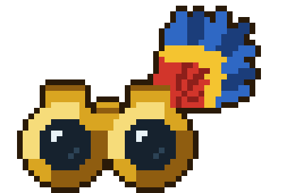

  

<h1 align="center">Una spedizione ornitologica</h1>

<em>Isole, nebbie e piume. A turni.</em>

<a href="https://gabrielemartire.github.io/una-spedizione-ornitologica/"><strong>▶ Gioca nel browser</strong></a>

---

**Anno 1500.** Hai un binocolo, un taccuino quasi vuoto e abbastanza monete per pagare la ciurma per una decina di giorni.

Là fuori c'è un arcipelago che nessuno ha mai disegnato. Da qualche parte, vicino a una cascata, canta un uccello dal becco blu che nessun naturalista ha mai visto. Da qualche altra parte c'è un orso che non ha nessuna voglia di essere osservato.

Non sei un guerriero. Sei uno studioso. Ti muovi piano, ti nascondi nei cespugli, piazzi una tagliola dove passerà il cinghiale, e quando l'uccello finalmente si posa trattieni il fiato e prendi appunti.

## Cosa ti aspetta

- 🧭 **Un mondo nuovo a ogni viaggio.** L'arcipelago è generato ogni volta: isole, biomi e zone cambiano. Alcuni uccelli, in certi viaggi, semplicemente non ci sono.
- ⛵ **Navigazione libera.** Sterzi la nave sul globo in tempo reale e attracchi dove ti pare. Ma ogni giorno in mare costa la paga della ciurma.
- 🗺️ **Zone esplorate a turni.** Ogni sbarco apre una mappa nuova, con alberi, ruscelli, uccelli, mostri e qualche tesoro.
- 🪤 **Furbizia, non spada.** Gli orsi caricano in linea retta, i lupi ti circondano, i cinghiali non sanno curvare. Usa il terreno, le esche e le trappole.
- 🖼️ **Cartoline che non mentono.** Ogni zona ha il suo panorama in ASCII: se nella cartolina c'è una cascata, laggiù c'è davvero una cascata, e forse anche chi ci vive.
- 🏰 **Due città.** Un forte di pietra sul mare e un porticciolo tra le montagne di un fiordo. Vendi, ti curi, compri voci da marinai ("ho visto un uccello strano, a nord..."). La Società ornitologica premia chi completa una specie.
- 🤠 **Ricercati.** Nella bacheca del porto a volte c'è un avviso: segui il fumo, insegui il fuggitivo tra gli alberi (spara!) e portalo alla gendarmeria per la taglia.
- 📜 **Il taccuino sopravvive.** Quando il viaggio finisce, perché la ciurma ti ha abbandonato o perché un orso ha avuto la meglio, scarichi l'attestato in PDF. Più avanti avrà un codice: inseriscilo nel viaggio successivo e riprendi la collezione.

**57 uccelli** da scoprire: buffi, solenni, leggendari, e qualcuno vero.

## Niente salvataggi

Accendi, giochi, e il viaggio dura finché giochi. Se chiudi, il mondo svanisce. È un gioco "da flash": una partita è una storia sola, e la prossima sarà diversa.

Solo il taccuino, scritto a mano e timbrato con il suo codice, viaggia con te.

## A che punto siamo

🚧 **In costruzione, ma già giocabile** (versione 0.4, le novità sono nelle [patch note](PATCH-NOTE.md)). Si naviga sul globo in tempo reale, si guarda la costa col binocolo, si sbarca e si cercano 57 uccelli che si fanno vedere solo a certe ore, tra orsi di giorno, lupi di notte e cinghiali all'alba. Niente aiuti: l'uccello si cerca a occhio. La giornata è divisa in alba, pomeriggio e notte: ripartire costa tempo, la ciurma va pagata, il diario annota tracce, avvistamenti, entrate e uscite, e a fine viaggio si scarica l'attestato in PDF. Nelle città si cammina tra la gente: medico, taverna con le voci sugli uccelli rari, mercato per vendere gli oggetti rituali trovati a terra, la bacheca dei ricercati, la gendarmeria e la Società ornitologica. Mancano ancora l'emporio e il codice del taccuino: il progetto completo è descritto nel [documento di design](docs/DESIGN.md).

## Grazie

- A **Eigen Lenk** e al suo [*Pioneers*](https://www.pcgamer.com/uk/pioneers-set-sail-for-the-new-world-with-this-novel-exploration-rpg), che ha acceso la scintilla.
- Agli autori di [game-icons.net](https://game-icons.net) (CC BY 3.0).
- A te, che sei atterrato qui. Occhi al cielo.
